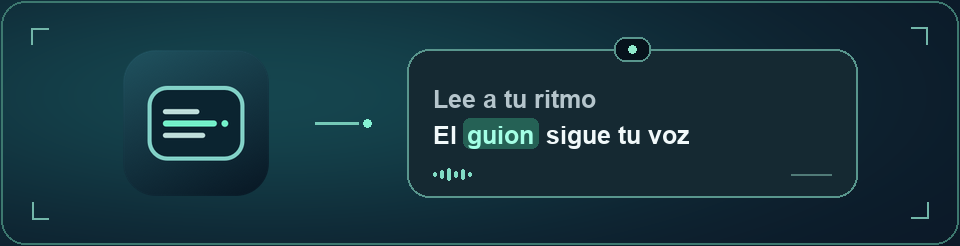

# Teleprompter

Teleprompter nativo para macOS que sigue tu voz. El lector flotante se sitúa cerca de la cámara y mantiene la línea activa a la misma altura mientras lees.

[](https://github.com/JuanCarlosAcostaPeraba/teleprompter/releases/latest/download/Teleprompter-macOS.dmg)

[](https://github.com/JuanCarlosAcostaPeraba/teleprompter/releases/latest/download/Teleprompter-macOS.dmg)

[](https://github.com/JuanCarlosAcostaPeraba/teleprompter/releases/latest)
[](#descargar-e-instalar)
· [English](README.md)

## Descargar e instalar

**[Descargar Teleprompter para macOS (.dmg)](https://github.com/JuanCarlosAcostaPeraba/teleprompter/releases/latest/download/Teleprompter-macOS.dmg)**

Requiere **macOS 14 o posterior**. La descarga admite Apple Silicon e Intel.

1. Abre la imagen de disco descargada.
2. Arrastra **Teleprompter** a **Aplicaciones** y ábrelo desde allí.
3. Usa el icono de Teleprompter en la barra de menús para pegar o editar un guion y abrir el lector.

La descarga pública usa firma ad hoc y carece de notarización. Si macOS bloquea la descarga, puedes compilar la app en tu Mac con las instrucciones de abajo. La primera vez que actives la escucha, macOS puede pedir permiso para acceder al micrófono y al reconocimiento de voz.

## Leer un guion

- Elige el idioma de reconocimiento en Ajustes. Para preparar otro idioma, pulsa **Configurar idiomas en Dictado…** y ve a **Teclado → Dictado → Idiomas** en Ajustes del Sistema. La disponibilidad local depende del idioma y del Mac.
- Abre el lector con el guion guardado o con el texto del portapapeles. El portapapeles conserva el guion guardado y el seguimiento por voz omite las indicaciones entre corchetes.
- El lector se abre debajo de la cámara. Arrastra sus bordes para ajustar el tamaño o haz doble clic en el tramo libre de arriba para volverlo a centrar. Ajustes muestra una vista previa.
- Pulsa una palabra o usa las flechas para moverte manualmente. La línea activa se mantiene cerca del borde superior y deja visible la anterior. El botón de escucha muestra la entrada de audio activa. Puedes desactivar la escucha automática en Ajustes.
- En macOS 26 o posterior puedes activar o desactivar Liquid Glass. Los iconos del Dock y de la barra de menús se pueden ocultar por separado. Puedes reabrir Ajustes con el script de Raycast de [scripts/raycast](scripts/raycast) o con `teleprompter://settings`.

## Actualizaciones

Pulsa **Buscar actualizaciones** en Ajustes. La app consulta la última versión estable de GitHub. Si hay una nueva, **Descargar y abrir DMG** la descarga y verifica desde la app. Cierra Teleprompter, arrastra la nueva versión a Aplicaciones y reemplaza la anterior. El guion y las preferencias se guardan por separado y se conservan.

## Captura y privacidad

El guion y el reconocimiento se procesan en tu Mac. **Solicitar exclusión de captura** pide a macOS que excluya la ventana del lector. El resultado depende de la app y del método de captura. Comprueba la previsualización antes de compartir o grabar.

## Compilar desde el código

Usa Xcode 26 o posterior con sus herramientas de línea de comandos seleccionadas.

```sh
swift test
./scripts/build-app.sh
open dist/Teleprompter.app
```

Instala [uv](https://docs.astral.sh/uv/getting-started/installation/) para empaquetar un DMG universal con el diseño personalizado de Finder:

```sh
./scripts/build-app.sh --arch arm64 --arch x86_64
./scripts/build-dmg.sh
```

Sube `dist/Teleprompter-macOS.dmg` a una release estable de GitHub con etiqueta `vMAYOR.MENOR.PARCHE`. Conserva el nombre del archivo para que funcionen la descarga directa y la comprobación desde la app. En desarrollo local, puedes mantener la identidad de firma entre compilaciones con `TELEPROMPTER_SIGN_IDENTITY`. Los cambios en una compilación con firma ad hoc pueden hacer que macOS vuelva a pedir permisos.
